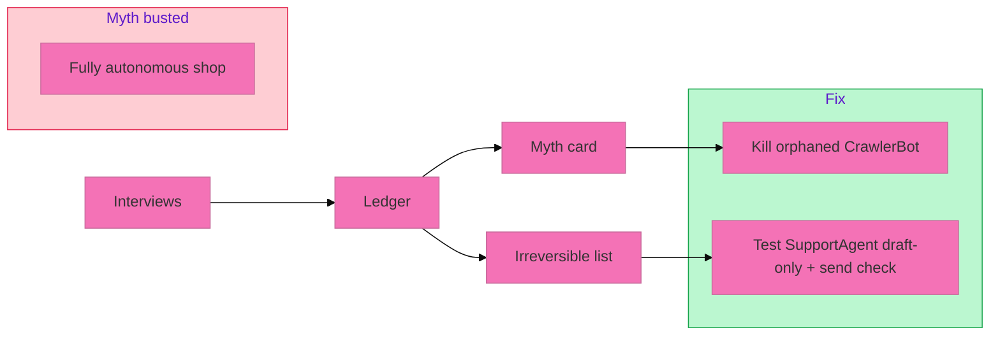

# Worked example — Paper Lantern Labs (fictional)

**Paper Lantern Labs** is a made-up ten-person shop that sells printable party kits online. Nothing below is a real company. Numbers illustrate the kit only.

## Spec

| Item | Value |
|---|---|
| Process | **Customer support + order fixes** |
| Window | Two weeks |
| Sponsor claim | "The support agent runs itself" |

## 1. Interviews (summary)

| Role | Evidence ID | Paraphrase |
|---|---|---|
| Frontline support | Q-01 | "I rewrite every refund email. The agent guesses policy." |
| Frontline support | T-02 | Rework on three of ten tickets per day, about fifteen minutes each |
| Manager | M-01 | Two tools billed: chat agent plus a second SEO crawler nobody uses for support |
| Sponsor | (claim) | "We bought autonomy" — compared to Q-01 and T-02 below |

## 2. Waste ledger (filled rows)

### Flow rows

| ID | Flow | Tool | Monthly cost | Time (hrs/wk) | Waste type | Fix | Disposition |
|---|---|---|---:|---:|---|---|---|
| F-01 | Ticket draft → send | SupportAgent | 120 | −4 (rework) | Rework | Stay on Do: draft-only; add send check | TEST |
| F-02 | Nightly SEO scan | CrawlerBot | 85 | −0.5 (alerts) | Orphan | Kill from this process | KILL |
| F-03 | Status page update | Manual | 0 | +1 (saved) | — | Keep manual | KEEP |

### Inventory (rung)

| ID | System | Job | Rung claimed → actual | Evidence |
|---|---|---|---|---|
| I-01 | SupportAgent | Ticket replies | Automate → **Do** (human rewrites and sends) | Q-01, T-02 |
| I-02 | CrawlerBot | SEO scan | **Automate**, orphaned from support path | M-01 |
| I-03 | Manual status | Status page | **Do** | T-03 |

Rung move for F-01: stay on **Do**, one step from false Automate (remove auto-send, keep draft assist).

### AI-theater meetings

| ID | Date / roles | Purpose | Min × people | Shipped? | Verdict | Evidence |
|---|---|---|---:|---|---|---|
| MT-01 | Week 1 / sponsor, vendor | "AI transformation roadmap" for support | 90 × 4 | No | Shorten | M-02 (manager: no ticket change after) |

### Totals (example arithmetic)

Rework about 4 hrs/wk; meeting load about 6 person-hrs/wk for the sample row above. Tool leakage about 205/mo allocated to this process at rough 70% → about 143/mo. Rework time cost left unknown.

## 3. Myth card (supported)

| Field | Content |
|---|---|
| Claim | "The support agent runs itself" |
| Source | Sponsor role |
| Evidence | Q-01 quote; T-02 time sample; A-01 autopsy below |
| Flow shows | Agent drafts; human rewrites and sends every refund |
| Cost of believing | Continued rework; false confidence to add more auto-send |
| Audit question | Which support-agent actions cannot be undone, and what fixed check sits in front of each? |
| Decision | **TEST** draft-only with irreversible check on send |

## 4. Confusion card

| Field | Content |
|---|---|
| Moment | F-01 refund email step |
| Expected | Agent sends correct policy email |
| Actual | Wrong return window; agent tried to send |
| Workaround | Support lead rewrites and sends manually |
| Cost signal | About 22 min plus trust hit on three of ten tickets |
| Ask | Can draft-only plus a fixed send check stay on the Do rung? |

## 5. Autopsy A-01

| Field | Content |
|---|---|
| Task | Refund approval email |
| Expected | Policy-correct draft ready to send |
| Actual | Wrong return window; agent attempted send |
| Rework | 22 min; support lead caught before customer saw it |
| Fix | Remove auto-send; fixed check on Send class |

## 6. Irreversible checklist (excerpt)

| Flow | Step | Class | Fixed check | Status before audit |
|---|---|---|---|---|
| F-01 | Email to customer | Send | Human confirms recipient and body | **Missing** — agent could send |
| F-01 | Refund in shop admin | Pay | Human confirms amount | Present |
| F-03 | Deploy status page | Publish | Human confirms URL | Present |

**Audit result:** one unchecked Send path. Ship blocked until check added.

## 7. Kill / keep / test

| Decision | Item | Why |
|---|---|---|
| KILL | CrawlerBot for this process | Orphan Automate; M-01; not in support path |
| KEEP | Manual status updates | Do rung; saves time; no rework signal |
| TEST | SupportAgent draft-only + send check | Do not jump to Automate; Q-01 T-02; myth card |

## 8. How the pieces fit

Interviews surfaced rework and an orphan tool. Inventory showed Automate theater on SupportAgent while work stayed on Do. The ledger tied money, time, and one theater meeting. The myth card and audit question pointed at irreversible send. The confusion card pinned the refund moment. Decision: kill CrawlerBot, test SupportAgent on Do with checks, keep manual status.

Use this shape on your org. Replace every value with your samples.
