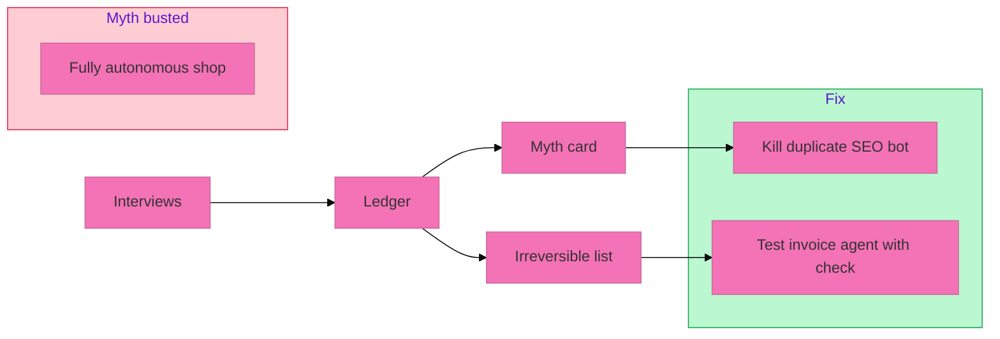

# Worked example — Paper Lantern Labs (fictional)

**Paper Lantern Labs** is a made-up ten-person shop that sells printable party kits online. Nothing below is a real company. Numbers illustrate the kit only.

## Spec

| Item | Value |
|---|---|
| Process | **Customer support + order fixes** |
| Window | Two weeks |
| Sponsor claim | "The support agent runs itself" |

## 1. Interviews (summary)

| Role | Evidence ID | Paraphrase |
|---|---|---|
| Frontline support | Q-01 | "I rewrite every refund email. The agent guesses policy." |
| Frontline support | T-02 | Rework on three of ten tickets per day, about fifteen minutes each |
| Manager | M-01 | Two tools billed: chat agent plus a second SEO crawler nobody uses for support |
| Sponsor | (claim) | "We bought autonomy" — compared to Q-01 and T-02 below |

## 2. Waste ledger (filled rows)

| ID | Flow | Tool | Monthly cost | Time (hrs/wk) | Waste type | Fix | Disposition |
|---|---|---|---:|---:|---|---|---|
| F-01 | Ticket draft → send | SupportAgent | 120 | −4 (rework) | Rework | Shrink to draft-only; human send | TEST |
| F-02 | Nightly SEO scan | CrawlerBot | 85 | −0.5 (alerts) | Orphan | Not in support path | KILL |
| F-03 | Status page update | Manual | 0 | +1 (saved) | — | Keep manual | KEEP |

**Totals (example arithmetic):** rework about 4 hrs/wk; tool leakage about 205/mo allocated to this process at rough 70% → about 143/mo plus rework time cost left as unknown hours.

## 3. Myth card (supported)

| Field | Content |
|---|---|
| Claim | "The support agent runs itself" |
| Source | Sponsor role |
| Evidence | Q-01 quote; T-02 time sample; A-01 autopsy below |
| Flow shows | Agent drafts; human rewrites and sends every refund |
| Cost of believing | Continued rework; false confidence to add more auto-send |
| Decision | **TEST** draft-only with irreversible check on send |

## 4. Autopsy A-01

| Field | Content |
|---|---|
| Task | Refund approval email |
| Expected | Policy-correct draft ready to send |
| Actual | Wrong return window; agent attempted send |
| Rework | 22 min; support lead caught before customer saw it |
| Fix | Remove auto-send; fixed check on Send class |

## 5. Irreversible checklist (excerpt)

| Flow | Step | Class | Fixed check | Status before audit |
|---|---|---|---|---|
| F-01 | Email to customer | Send | Human confirms recipient and body | **Missing** — agent could send |
| F-01 | Refund in shop admin | Pay | Human confirms amount | Present |
| F-03 | Deploy status page | Publish | Human confirms URL | Present |

**Audit result:** one unchecked Send path. Ship blocked until check added.

## 6. Kill / keep / test

| Decision | Item | Why |
|---|---|---|
| KILL | CrawlerBot for this process | Orphan; M-01; not in support path |
| KEEP | Manual status updates | Saves time; no rework signal |
| TEST | SupportAgent draft-only + send check | Rework Q-01 T-02; myth card |

## 7. How the pieces fit

Interviews surfaced rework and an orphan tool. The ledger tied money and time to each flow. The myth card needed quote plus time plus autopsy. The irreversible list showed the real risk: auto-send without a fixed check. Decision: kill waste, test the agent only where humans still own send and pay.

Use this shape on your org. Replace every value with your samples.
