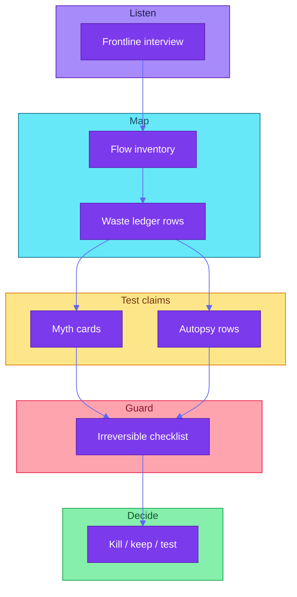

# ai-flow-audit

> **Load rule:** Templates use placeholders only. No live customer data in emits. Money, send, pay, delete, merge, and publish stay human-checked. Not legal or tax advice.



## Spec

| Piece | File | Job |
|-------|------|-----|
| Waste ledger | [references/waste-ledger.md](references/waste-ledger.md) | One row per flow: tool, monthly cost, time saved or lost, waste type, fix |
| Myth card | [references/myth-card.md](references/myth-card.md) | Claim, evidence, cost of believing, audit question |
| Irreversible checklist | [references/irreversible-checklist.md](references/irreversible-checklist.md) | Every undoable agent action plus fixed human check |
| Interview guide | [references/interview-guide.md](references/interview-guide.md) | Frontline first, then manager, then sponsor |
| Worked example | [../../examples/paper-lantern-worked-example.md](../../examples/paper-lantern-worked-example.md) | Fictional company end to end |

**Evidence bar:** A myth or maturity claim needs at least two of: time sample, money sample, frontline quote, failed-task autopsy. Do not score on assertion alone.

Slash: `/ai-flow-audit`. Match “waste ledger”, “myth card”, “audit AI flow”, “agent waste”.

## Activate / skip

| Signal | Action |
|--------|--------|
| New AI tool or agent flow in a small team | Activate |
| Spend or rework feels off but story sounds great | Activate |
| Single file fix with known verify | Skip |
| Pure math uncertainty with no tools | Prefer **uncertainty-laws** |

## Instructions

1. Pick **one process** and a sample window. Set a stop date if evidence stays thin.
2. Run **interview-guide** frontline first. Capture evidence IDs, not names.
3. Fill **waste-ledger** inventory and time or money samples. Mark unknowns.
4. Name each flow's **rung** (Ask → Do → Automate → Staff) before proposing a fix. Move at most one rung per change.
5. Write **myth cards** only when the evidence bar is met.
6. Walk **irreversible-checklist** for every automated or agent step in the flow.
7. Emit kill / keep / test with owners and next check dates.
8. Point the user at the fictional worked example when they want a full walkthrough.

## Emit (required)

```markdown
## AI flow audit
| Field | Value |
|-------|--------|
| **process** | |
| **sample window** | |
| **flows in ledger** | count |
| **myth cards** | count (supported / candidate) |
| **irreversible acts** | count unchecked |
| **measurable leakage** | range or unknown |
| **kill / keep / test** | short list |
| **next evidence** | one item |
```

## Hard nos

- No PII, tokens, emails, phone numbers, or real employer names in emits.
- No fake precision when inputs are estimates.
- No promises of savings before evidence is reviewed.
