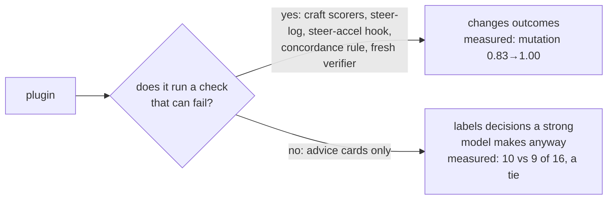
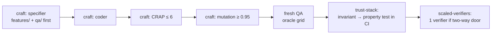
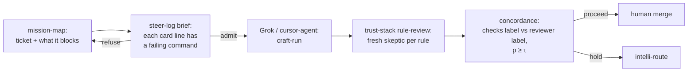
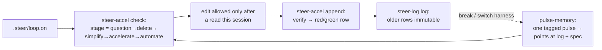
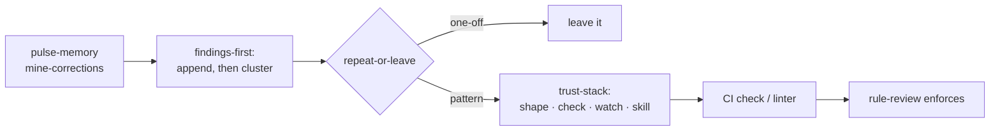
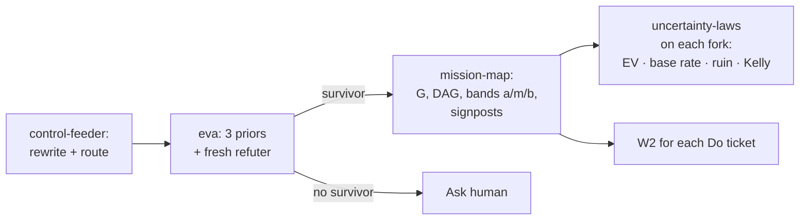
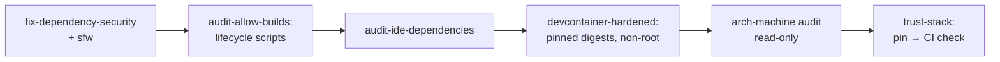

# Plugin workflows: where they pay off

Where plugin combinations pay off. Evidence comes from two blind A/B runs on `laptop-1` (2026-10-21/22) and the shared `flows/specs/`.

## The one rule the evidence supports

This is `trust-stack` A1 applied to the suite itself: the earliest layer wins. A combination is worth running when it chains **gates**: a fresh verifier, an append-only log, a human sign-off. Chaining only **advice** isn't.

Evidence tags: **measured** (A/B on this machine) · **gated** (executable checkers exist, no A/B yet) · **untested**.

## Pick a workflow

| Your task looks like | Workflow | Evidence |
|---|---|---|
| Logic where a wrong answer costs money or access | W1 Correct-by-spec | measured |
| Claude plans, Grok or cursor-agent builds | W2 Planner → builder handoff | gated |
| Work that spans days, breaks or harness switches | W3 Long stretch | gated |
| The same agent mistake keeps coming back | W4 Misses → checks | partly measured |
| "Should we even build this?" | W5 Fog → map | untested |
| Dependency or host security sweep | W6 Hardening | gated |
| UI that clips or overflows across viewports | W7 Layout stability | gated |
| Mail, PRs and calendar into focus blocks | W8 Personal ops | gated |
| One-sitting bug fix with a known repro | **none**: route `light` and fix it | measured (tie) |

---

## W1 Correct-by-spec: billing, refunds, entitlements, parsers

**Real cases:** proration and refund splits, tax rounding, seat or entitlement checks, permission matrices, date/time parsers. Add `si:peram_deterministic_saas` when there's state: an explicit state machine, idempotent writes, an audit row.

**Why the combination matters:** the baseline's tests were green and still missed a wrong tie-break sort. Only mutation testing exposed it. Writing the spec first stops tests from being shaped by whoever wrote the code. `trust-stack` then moves the invariant into a property test, so the next change can't silently break it.

**Measured:** worst CRAP 27.1 → 6.0, mutation 0.83 → 1.00, 10 → 35 tests. Both versions passed a ~320k-case oracle, so the gain is in **proof and maintainability**, not first-pass correctness.

## W2 Planner → builder handoff (the house loop)

**Real cases:** every Grok-built PR. `steer-log` refuses a brief whose claims have no failing command, so "done" means a command that was red is now green, not the builder's say-so. `concordance` stops a confident "LGTM" from overriding red checks: it proceeds only when both labels match and p ≥ τ.

**Why the combination matters:** each gate catches a different lie. `steer-log` catches a vague spec, `craft` catches weak tests, `rule-review` catches broken house rules, and `concordance` catches the reviewer and the checks disagreeing.

**Evidence:** the checkers run, but not yet with a weaker builder. **This is the highest-value next A/B**: rerun the issue 66 task with Grok as the builder in both arms.

## W3 Long stretch: migrations, multi-day refactors, harness switches

**Real cases:** a week-long migration, switching between Claude Code, Grok and Cursor mid-task, resuming after a weekend.

**Why the combination matters:** the chat stops being the record. The stage log is append-only, and the hook refuses edits to files not read this session, which blocks stale-context edits after a resume. `pulse-memory` brings back only a small tagged pointer, not a transcript. You can't automate a step the log hasn't first deleted and simplified.

**Evidence:** gated, not yet run end-to-end. Both A/B tasks fit in one sitting, so none of this was exercised.

## W4 Recurring misses → checks

**Real cases:** "agents keep writing bash-4 syntax", "builders skip the approval step before a push", turning review comments into CI rules.

**Why the combination matters:** it compounds. Each repeated miss becomes a check rather than another reminder to the model.

**Measured, partly:** in the issue 66 run, `trust-stack` picked the right layer (a macOS CI job) and the right search for the same bug elsewhere. Its search only covered `*.sh` and returned a false all-clear. **The workflow is only as good as the check at the end.** Make the contagion search look at shebangs and run the real interpreter.

## W5 Fog → map: new product, migrate-or-not, career or mission

**Real cases:** "should we build our own auth or buy one", "is this rewrite worth it", picking between two jobs. `odysseus` sits on PLAN to flag a shiny rewrite or a big-bang cutover.

**Why the combination matters:** it doesn't let you build from a fog map. EVA must end with a surviving hypothesis or an Ask, `mission-map` must name one checkable arrival, and work starts only through W2.

**Evidence:** untested, and hard to score with pass/fail. Risk: a lot of overhead for a decision you could make in a minute.

## W6 Hardening: dependency and host security

**Real cases:** the day an npm compromise hits the news, onboarding a new repo, before giving an agent shell access.

**Evidence:** gated, not run.

## W7 Layout stability without pixel snapshots

`lcv-implement` proposes `data-lcv` marks, you accept them, then `layout-content-view` checks that every must-show element is unclipped at each viewport, and `craft` writes it as a `.feature` acceptance test.

**Real cases:** responsive dashboards, i18n strings that overflow, SI chat UIs.

**Evidence:** gated, not run.

## W8 Personal ops

`tstack` capture-sweep (mail, calendar, chat, PRs; read-only; money, posting and signing held for you) → `tomato-loop` (one Do from the critical path) → `premflow` pomodoro → `harvest` → `mission-map` replan on shock.

**Real cases:** a morning triage of PR reviews and meetings into focus blocks.

**Why the combination matters:** reading and writing are kept apart, and money, posting and signing always wait for you.

**Evidence:** gated, not run.

---

## When not to use them

- **One-sitting fixes with a known repro.** The issue 66 A/B tied (10 vs 9 of 16) at equal cost. Route `light` and just fix it.
- **Advice-only chains.** If no step can fail, the chain adds labels, not safety.
- **A vague request treated as a single ask.** In the A/B, the router routed a three-goal request `light` and skipped `craft` and `scaled-verifiers`, the two plugins that would have caught the remaining fail-open bug. Send requests like that through `control-feeder`.

## Next evidence to collect

1. W2 with Grok as the builder in both arms, using the same frozen rubric and `score.sh`.
2. W3 across a real break: resume in a different harness and count stale-context edits blocked.
3. W4 run for two weeks on real review comments: how many misses became checks, and how many repeated afterwards.
