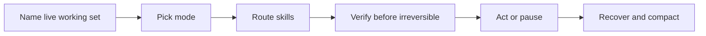

# Live engine

**Action runner for coordinating work** — not a bot, not a second chat persona, not part of flowingstack.

One live working set, few specialists, verify before irreversible acts, then recover.

Slash: `/live-engine`.

Renamed from **Live context** (plugin id `live-context`).

## Works with (separate systems)

- **pulse memory** — sparse past traces kept because they should change a later action (a qualifier for the next decision), not a context dump. This plugin does not embed pulse memory.
- **Ensembly** — a separate workflow system you can run alongside. This plugin does not replace or own Ensembly.

## Process



| Use this when | Skip when |
|---------------|-----------|
| Non-trivial or multi-step work | One short reply with no extra help |
| A turn would fan out many specialists | Pure maintenance in rest mode |

---

## Install

```bash
grok plugin marketplace add https://github.com/p10ns11y/plugins.git
grok plugin marketplace update
grok plugin install live-engine --trust
```

---

## Verify

```bash
./test/test-thin.sh
```
