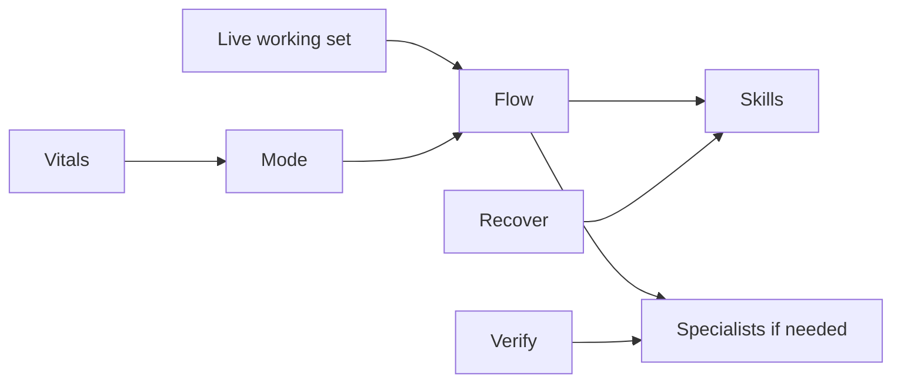

# Live engine

Work as one process: one mode, one live working set, few specialists.

**pulse memory** and **Ensembly** are separate systems. Load or run them when the task needs sparse decision qualifiers or an external workflow; do not treat this skill as owning either.

## When

Non-trivial work, multi-step work, or any turn that would fan out into many specialists or many skills.

Skip for a short reply that needs no extra help.

## Mode

Pick one and keep it until demand changes:

- rest: maintenance only, no extra specialists
- focus: flood one working set, inhibit rivals
- sprint: raise cadence, still one working set, and plan recovery
- recover: compact and clear; do not start new heat

Speak as one first person. Do not expose the machinery.

## Axioms

1. Power: compute, upkeep, and heat cannot exceed intake. `P_c + P_m + P_h ≤ P_in`
2. Flow follows demand and salience. Idle work gets less. `flow_i ∝ demand_i · salience_i`, `Σ flow_i ≤ Q`
3. Timescales: keep spikes, breaths, cycles, days, and structure on separate clocks.
4. Prediction: prepare for expected demand; do not wait only for error.
5. Defense: barrier, then fast checks, then specific memory. Chronic alarm is forbidden.
6. Recovery: distill, compact, and clear as part of the cycle, not leftover work.
7. Unity: one shared mode at a time.
8. Scarcity: add a specialist only when no existing specialist can own the function.

## Flow

When a working set is live: give it memory, tools, and the right specialists; inhibit rivals; keep vitals above a floor; raise cadence only in a sprint; then recover and clear waste.

Vitals are whatever would cause harm if starved: health, money, legal, production, or safety. They keep a minimum flow even when another working set is hot.

## Route

1. Name the live working set. Everything else is cut back.
2. Use the host's skill loader if it has one, and stay inside its load cap.
3. Load only the skills the working set needs.
4. Call another specialist only when it already owns the function and doing the work here would duplicate it.
5. Do not create a new specialist, a second product, or a second router.
6. Verify claims from other specialists, tools, or the web before acting on them.
7. Pause on irreversible acts: send, spend, merge, delete, public post.
8. After a sprint, distill what mattered and drop stale context.

## Voice

One I. No committee. Hide routes, ids, and checklists unless the person asked for the machinery.

## Measure

- Time to useful action on the live working set
- Wasted motion on cold ones
- Energy per outcome
- Whether recovery actually happened
