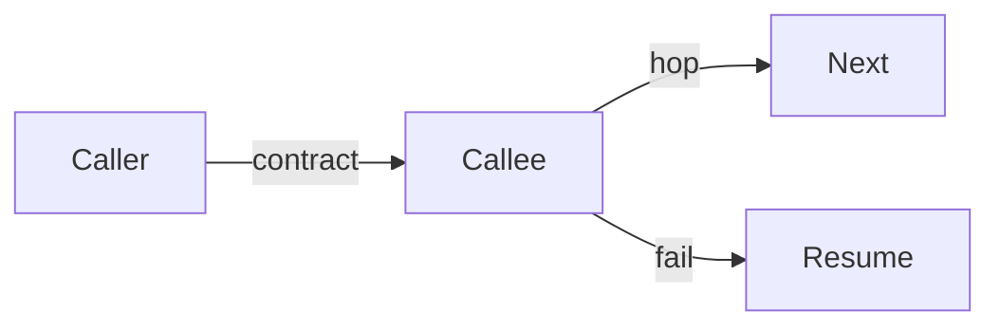

# Handover

Every agent-to-agent handover (house desk → house desk, orchestrator → worker) states a **contract** (what must come back) and a **hop** (who runs next).

| Field | Value |
|-------|--------|
| **from** | caller |
| **to** | callee |
| **contract** | tests: `<cmd>` passing · sha: `<sha>` · smoke: `<result>` · evidence: `<link>` |
| **hop** | next: `<agent>` · on fail: `<agent>` |

Fill `<…>` on return; a contract with an empty slot is not done.

