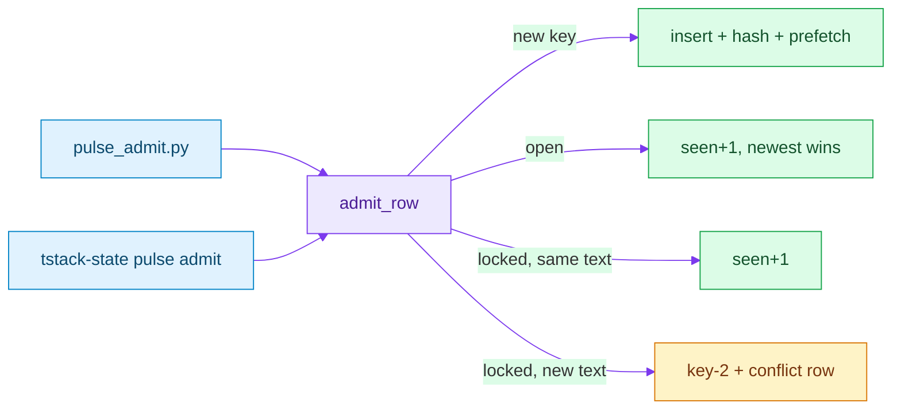

# Pulse-memory store (SQLite)

Do not dump transcripts into the context window. Keep **archive** (append-only) and **memory** (admitted, tagged) as two tables. Pattern from `agent-local-db`: WAL, best-effort writes, never block the agent loop.

Default file: $XDG_DATA_HOME/tstack/state.sqlite, or ~/.local/share/tstack/state.sqlite when XDG_DATA_HOME is unset. TSTACK_STATE_DB overrides, else PULSE_MEMORY_DB. Writes, FTS rebuild, and migrations go through tstack-state (see references/state.md in the tstack plugin). Do not move or delete ~/.local/share/pulse-memory/pulse.sqlite. Point PULSE_MEMORY_DB at that file to keep using it. Mode 0600.

## Tools

| Tool | Job |
|------|-----|
| `tstack-state` | writes, FTS rebuild, and migrations. The `sqlite3` CLI is inspect only. |
| `scripts/pulse_init_db.py` | create the store at `PULSE_MEMORY_DB`, mode 0600; idempotent |
| `scripts/pulse_admit.py` | admit one tagged snippet; store `verify_hash` and `prefetch_key` |
| `scripts/pulse_retrieve.py` | return one verified pulse, or a few, never the whole store |
| `scripts/pulse_backfill.py` | fill empty hash and prefetch values; no deletes |
| `/pulse-memory` skill | tag + resolve in the conversation |
| `/workflow pulse-memory` | one pulse cycle over thinking + harness files |
| scheduler (host) | fire the workflow; pass `as_of` (script has no wall clock) |
| Markdown pulse files | human-readable inject (`pulse.md`); not the SoT |

No extra server. No vector DB required. Similarity-only retrieval is how stale constraints sneak back; FTS + `time` + `status` + `supersedes` is the filter.

## Schema (v1)

```sql
PRAGMA journal_mode = WAL;
PRAGMA foreign_keys = ON;

CREATE TABLE IF NOT EXISTS schema_migrations (
  version INTEGER PRIMARY KEY,
  applied_at TEXT NOT NULL
);

-- ARCHIVE: residue. Full fidelity. Never injected whole.
CREATE TABLE IF NOT EXISTS archive_events (
  id INTEGER PRIMARY KEY,
  ts TEXT NOT NULL,
  source TEXT NOT NULL,
  payload TEXT NOT NULL,
  correlation_id TEXT
);

-- MEMORY: admitted traces only. Dedup by natural key.
CREATE TABLE IF NOT EXISTS memory_traces (
  id INTEGER PRIMARY KEY,
  nat_key TEXT NOT NULL UNIQUE,  -- e.g. apply/sitting/cap
  snippet TEXT NOT NULL,         -- ≤ ~120 tokens
  source TEXT NOT NULL,
  time TEXT NOT NULL,            -- ISO-8601 or 'unknown'
  status TEXT NOT NULL CHECK (status IN
    ('user-stated','tool-verified','inferred','unknown')),
  kind TEXT NOT NULL CHECK (kind IN
    ('data','context','fact','memory')),
  lock TEXT NOT NULL DEFAULT 'open' CHECK (lock IN ('open','locked')),
  verify_hash TEXT,
  prefetch_key TEXT,
  seen_count INTEGER NOT NULL DEFAULT 1,
  superseded_by TEXT,            -- nat_key of later trace, or NULL
  first_seen TEXT NOT NULL,
  last_seen TEXT NOT NULL
);

CREATE VIRTUAL TABLE IF NOT EXISTS memory_fts USING fts5(
  nat_key, snippet, source, content='memory_traces', content_rowid='id'
);

CREATE TABLE IF NOT EXISTS conflicts (
  id INTEGER PRIMARY KEY,
  subject TEXT NOT NULL,
  left_id INTEGER NOT NULL REFERENCES memory_traces(id),
  right_id INTEGER NOT NULL REFERENCES memory_traces(id),
  resolution TEXT NOT NULL,      -- winner nat_key or 'not in the evidence'
  ts TEXT NOT NULL
);
```

Upsert: one path, `admit_row` in `scripts/pulse_common.py`. `pulse_admit.py` and `tstack-state pulse admit` both call it.



tstack-state also refuses `@` in any field.

## Admissions write path

1. Candidate claim → hint tags required; else reject.
2. Test: would it change **this** next action? No → `archive_events` only. The CLI also rejects an empty snippet, a snippet over 800 characters, an inferred write with no explicit source, and an inferred write marked locked.
3. Conflict with existing `nat_key` → do not average; rank time then status; loser stays archive; winner is memory; log `conflicts`.
4. Retrieve injects current `fact`, `memory`, or `context` rows with a matching hash, `superseded_by IS NULL`, newest and locked first, **LIMIT 8**. A `data` row comes back only by exact key. A mismatch or a stale row is unknown, not a dump.

## What not to add (YAGNI)

- Always-on hooks that pulse every tool call (Winds).
- A second graph/OS (Circe).
- Embeddings as the only retrieve (freshness dies).

## Neo4j — too early

Need today: **time**, **status rank**, **supersession**, **FTS**, ~tens of traces. SQLite already has that (`time`, `status`, `superseded_by`, `conflicts`, FTS5).

Neo4j pays off when you query **multi-hop graphs** (person–company–role–skill–thread) at volume. We do not have that query load. A graph server is ops (process, auth, backups) for a sitting that fits in one `LIMIT 8` pulse. Revisit if you need “who worked where / which constraint revoked which” as a graph walk **and** SQLite joins hurt. Until then: **SQLite only**.
