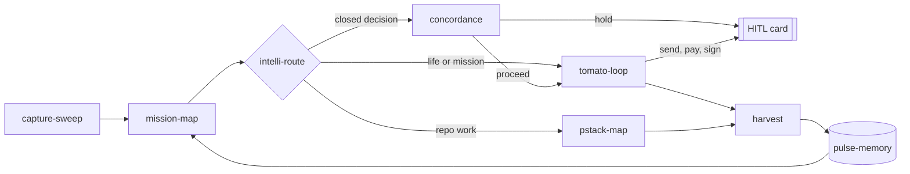

# tstack

pstack paces the code. tstack paces the person: one 🍅 block at a time.

Commands: `/tomato`, `/harvest`, `/replan`. Route table: [references/map.md](references/map.md).
Needs `premflow` on PATH for timed blocks. Loads mission-map, intelli-route, control-plane, pulse-memory, steer-log, steer-accel, concordance, trust-stack, si, michelin-kitchen and pstack-map; copies none. Credits: [NOTICE.md](NOTICE.md).
