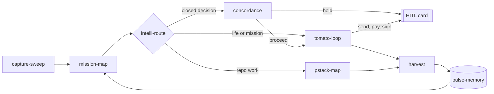

# tstack

pstack paces the code. tstack paces the person: one 🍅 block at a time.

Repo merges run `tstack/bin/merge-check`; concordance stays on closed decisions.

Commands: `/tomato`, `/harvest`, `/replan`. Route table: [references/map.md](references/map.md).

Capture reads mail, calendar, pull requests, and chats through four connectors. One card covers an ordinary read and a human stop for money, a send, or signing. The connectors do not send, pay, or sign.

State file: tstack-state, default $XDG_DATA_HOME/tstack/state.sqlite or ~/.local/share/tstack/state.sqlite. Premflow is optional, and only when its CLI is on PATH. Loads mission-map, intelli-route, control-plane, pulse-memory, steer-log, steer-accel, concordance, trust-stack, si, michelin-kitchen and pstack-map; copies none. Credits: [NOTICE.md](NOTICE.md).

End-to-end check: `tstack/test/test-e2e.sh`.
